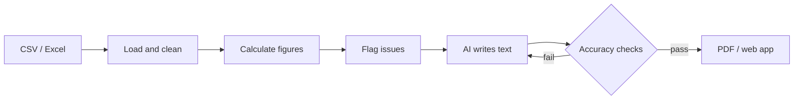

# AI-Powered Internal Data Report

Turns a raw data export (CSV or Excel) into a short, plain-language report: a summary, key figures and charts, and three to five recommended actions with owners and deadlines.

A free AI model writes the explanation, but **it never calculates a number**. Every figure is calculated in code, and every number the AI writes is checked against the data before the report is published.

**Sample output:** [`output/sample_report.pdf`](output/sample_report.pdf) (Groq) and [`output/gemini_report.pdf`](output/gemini_report.pdf) (same data, Google Gemini)

---

## Features

- **Figures from code, text from AI.** All figures are computed with Pandas. The AI receives only finished values.
- **Every number checked.** Each number in the AI's text must match a calculated figure and cite it as its source. Increases and decreases must be described in the right direction.
- **Self-correcting.** A draft that fails the checks goes back to the AI with the exact errors (up to three attempts). If it still fails, a built-in writer takes over and the report says so.
- **Traceable.** Every insight shows its source figures, and the report lists every figure used.
- **Swappable AI model.** Groq, Google Gemini, local Ollama or any OpenAI-compatible server. Switching is one setting.
- **Free tools only.** Python, Pandas, Matplotlib, Jinja2, WeasyPrint, Streamlit.

## How it works



| Step | Module | What it does |
| --- | --- | --- |
| Load and clean | `data_loader.py` | Removes duplicates, fixes labels, excludes invalid rows, logs every change |
| Calculate | `metrics.py` | Revenue, orders, margin, discounts, returns and delivery, overall and by region, category and segment |
| Flag issues | `metrics.py` | Rules for return hot spots, delivery slowdowns, falling margin and growth |
| Prompt | `prompt.py` | Fixed instructions, figures as structured data, required JSON output |
| AI call | `llm.py` | The only module that talks to a model |
| Checks | `validation.py` | Numbers, sources, direction, summary and action rules |
| Orchestration | `narrative.py` | Call, check, correct, fall back |
| Report | `render.py`, `charts.py` | HTML template with charts, exported to PDF |

## Quick start

Requires Python 3.12. On macOS, install the PDF libraries first with `brew install pango`.

```bash
python3.12 -m venv .venv
source .venv/bin/activate
pip install -r requirements.txt
cp .env.example .env
```

Open `.env`, set `LLM_PROVIDER=groq` and add a free API key from [console.groq.com](https://console.groq.com). Then:

```bash
# Build a report from the command line
PYTHONPATH=src python -m ai_report.cli --data data/sample/orders.csv --out output

# Or use the web app
streamlit run app.py
```

Each run writes `report.pdf`, `report.html` and `report.json` (the figures sent to the AI, its text and the check results).

**No API key yet?** Use `--provider offline` to run the full pipeline with the built-in writer.

### Command-line options

| Option | Description |
| --- | --- |
| `--data` | CSV or Excel file (required) |
| `--provider` | `groq`, `gemini`, `ollama`, `openai_compatible` or `offline` |
| `--model` | Model name; defaults to the provider's default |
| `--context` | One line of business context for the AI, for example "Wholesale promotion ran all October" |
| `--out`, `--stem` | Output folder and file name (default `output/report`) |
| `--no-pdf` | Skip the PDF |

## AI providers

| Provider | Setup | Default model |
| --- | --- | --- |
| `groq` | Free key from [console.groq.com](https://console.groq.com), set `GROQ_API_KEY` | `openai/gpt-oss-120b` |
| `gemini` | Free key from [Google AI Studio](https://aistudio.google.com), set `GEMINI_API_KEY` | `gemini-3.8-flash` |
| `ollama` | Install [Ollama](https://ollama.com), run `ollama pull llama3.1:8b` | `llama3.1:8b` |
| `openai_compatible` | Set `OPENAI_COMPAT_BASE_URL` (and `OPENAI_COMPAT_API_KEY` if needed) | Set with `LLM_MODEL` |
| `offline` | Nothing | Built-in rule-based writer |

Providers rename and retire models often. If a default is no longer available, set `LLM_MODEL` to a current one.

**Data privacy:** only calculated totals are sent to the AI, never individual records. On Gemini's free tier, Google may use inputs to improve its products. For sensitive data, use Groq, a paid tier or a local Ollama model.

To add a provider, subclass `LLMClient` in `llm.py`, implement `complete(system, user)`, and register it in `PROVIDERS`.

## Configuration

All settings are read from `.env`. Environment variables, including Streamlit Cloud secrets, take priority.

| Setting | Default | Description |
| --- | --- | --- |
| `LLM_PROVIDER` | `offline` | Which AI provider to use |
| `LLM_MODEL` | provider default | Model name for `LLM_PROVIDER` |
| `LLM_TEMPERATURE` | `0.2` | Lower is more consistent |
| `LLM_MAX_ATTEMPTS` | `3` | Drafts allowed before the built-in writer takes over |
| `LLM_TIMEOUT_S` | `180` | Seconds to wait for one answer before trying again |
| `LLM_MAX_TOKENS` | `8192` | Answer length limit, including a reasoning model's thinking |
| `LLM_REASONING_EFFORT` | `medium` | `low`, `medium` or `high` (Groq gpt-oss models) |
| `REPORT_TITLE` | Monthly Operations Report | Report title |
| `COMPANY_LABEL` | Sample Distribution Co. (anonymised) | Name shown on the report |
| `CURRENCY_SYMBOL` | `$` | Currency symbol |
| `ON_TIME_DAYS` | `5` | Delivery counts as on time within this many days |

Thresholds for flagging issues are in `src/ai_report/config.py`.

## Using your own data

The loader expects one row per order with these columns (case and spacing do not matter):

`order_id`, `order_date`, `region`, `category`, `segment`, `units`, `unit_price`, `unit_cost`, `discount_pct`, `returned`, `delivery_days`

At least two months of data are needed, because the report compares the latest month with the one before. For a different kind of data, adapt `data_loader.py` and `metrics.py`. The prompt, checks and report work on calculated figures and need no changes.

## Project structure

```
.
├── app.py                        Streamlit web app
├── src/ai_report/
│   ├── config.py                 Settings and thresholds
│   ├── data_loader.py            Load and clean
│   ├── metrics.py                Figures and issue flags
│   ├── prompt.py                 AI instructions
│   ├── llm.py                    AI providers (one module)
│   ├── validation.py             Accuracy checks
│   ├── narrative.py              Call, check, correct, fall back
│   ├── offline_writer.py         Built-in writer
│   ├── charts.py, render.py      Charts, HTML and PDF
│   ├── pipeline.py, cli.py       End-to-end run and command line
│   └── templates/                Report layout
├── tests/test_pipeline.py        38 automated tests
├── data/sample/orders.csv        Synthetic, anonymised sample data
├── scripts/generate_sample_data.py
├── output/                       Sample reports
├── .github/workflows/tests.yml   Tests on every push
├── requirements.txt              Pinned dependencies
└── packages.txt                  System libraries for Streamlit Cloud
```

## Testing

```bash
python -m pytest -q
```

The 38 tests cover data cleaning, figure accuracy against an independent calculation, detection of the issues in the sample data, every accuracy check, the correction loop and fallback, each AI provider (with simulated responses), Excel input and the web app start-up. GitHub Actions runs them, and builds a sample report, on every push.

## Deploying to Streamlit Community Cloud

1. Create an app from this repository with `app.py` as the main file.
2. Under **Advanced settings**, choose Python 3.12.
3. Under **Secrets**, add `LLM_PROVIDER` and the matching API key.

`packages.txt` installs the libraries needed for PDF export. Ollama is not available on Streamlit Cloud.

## Limitations

- The checks prove that every number is correct and sourced. Whether a recommended action is the right call remains a human decision.
- Free AI tiers have usage limits.
- The sample data is synthetic. Real exports need their columns mapped as described above.